<div align="center">

# Browser CLI

**Run several coding agents in your own signed-in browser at once. Each one works in its own tabs.**<br>
Chrome, Arc, Brave, Edge, Comet or Firefox, on this machine or another one over SSH.

[](https://www.npmjs.com/package/@phnx-labs/browser-cli)
[](https://github.com/phnx-labs/browser-cli/actions/workflows/test.yml)
[](LICENSE)

[Install](#install) · [Features](#features) · [Benchmark](#benchmark) · [Several agents](#several-agents-one-browser) · [How it compares](#how-it-compares) · [Docs](docs/README.md) · [Command reference](docs/command-index.md)

[phoenix.so/browser-cli](https://phoenix.so/browser-cli?ref=github) · [Why we open-sourced it](https://phoenix.so/blog/browser-cli?ref=github)

</div>

`browser` is one command an agent calls from its shell to drive the Chrome, Arc, Brave, Edge, Comet or Firefox profile you already use, on this machine or on another one over SSH. Every `browser start` opens a task that owns its tabs, so Claude Code, Codex and Cursor can work in the same signed-in browser at once without reading, typing into or closing each other's pages.

<p align="center">
  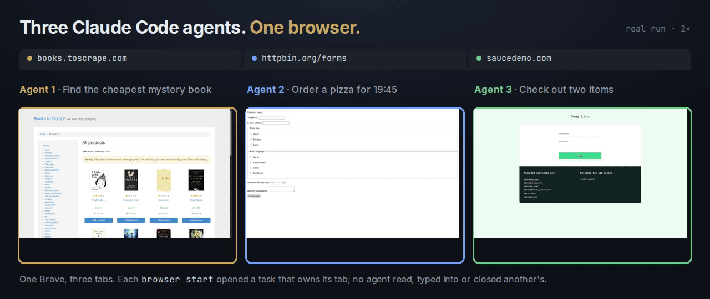
  <br><sub>A real run on 2026-10-19, shown at 2×: three Claude Code agents, one browser, each in the tab its task owns.</sub>
</p>

## Install

```sh
npm install -g @phnx-labs/browser-cli
npx skills add phnx-labs/browser-cli              # teaches your agents to use it
browser profiles create work --browser chrome     # once: chrome, brave, edge, chromium, comet or arc
browser use work
```

Firefox connects through a WebDriver BiDi endpoint ([profiles](docs/guide/profiles.md)). npm needs Node 22.5 or newer; `browser` itself is a compiled binary for macOS, Linux and Windows. In Claude Code the skill also installs as a plugin: `/plugin marketplace add phnx-labs/browser-cli`, then `/plugin install browser@browser-cli`.

Or let your agent set it up. Paste this into Claude Code, Codex, Cursor or any agent with a shell:

```text
Set up Browser CLI so you can use my web browser: https://github.com/phnx-labs/browser-cli

1. Install the CLI: npm install -g @phnx-labs/browser-cli (needs Node 22.5 or newer), then check it with: browser --version
2. Install its skill once, the way that fits you:
   - Claude Code: claude plugin marketplace add phnx-labs/browser-cli, then claude plugin install browser@browser-cli
   - Codex, Cursor, OpenCode or another agent: npx skills add phnx-labs/browser-cli -g -y -a <your agent's name, such as codex or cursor>
   Then read the skill now, before you use the browser: browser skills get
3. Set up the browser profile I asked for (this one setup step is the exception to the skill's rule against creating profiles): browser profiles create work --browser chrome, or brave or edge if I use one of those, then: browser use work. That profile starts signed out, so tell me I can sign in once, in the window it opens, to the sites I want you to use. If I use Arc, create it with --browser arc; for Comet add --attach-only. Both attach to the browser I already have open and signed in.
4. Try it: browser start --url https://news.ycombinator.com --snapshot, then browser done. Tell me the title of the top story.

Run browser <command> --help before guessing at a flag.
```

## Quick start

```console
$ browser start --url https://example.com --snapshot
readme-qs

Example Domain — https://example.com/
- link "Learn more" [ref=1]

$ browser click 1 --snapshot
Clicked

Example Domains — https://www.iana.org/help/example-domains
- link [ref=1]
- link "Domains" [ref=2]
- link "Protocols" [ref=3]
...

$ browser done
Completed task: readme-qs
```

Captured in Arc. In Chromium-family browsers `click --text "Learn more"` also clicks by name, and every action returns once the page has settled; everywhere, `--snapshot` prints the page it left, so an agent chains known steps in one shell call. Refs, `type`, `select`, dialogs, iframes and the rest are in [Driving a page](docs/guide/driving-a-page.md); every flag is in the [command reference](docs/command-index.md).

## Features

<table>
<tr>
<td width="50%" valign="middle">

### Set up in a minute

Install the CLI and its skill, create a profile for the browser you already use, and the first page with its clickable elements is one command away.

[Docs →](docs/use-cases/set-up-in-a-minute.md)

</td>
<td width="50%">
  <a href="docs/use-cases/set-up-in-a-minute.md"><picture><source srcset="docs/assets/readme-features/set-up-in-a-minute.webp" type="image/webp">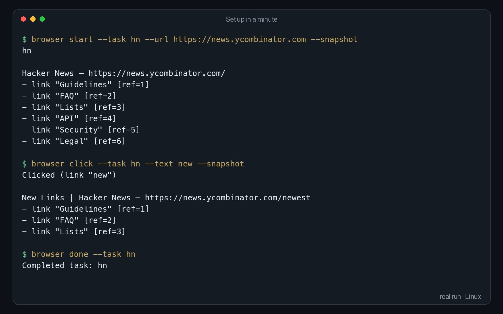</picture></a>
</td>
</tr>
<tr>
<td width="50%" valign="middle">

### Keep work and personal apart

Each profile has its own logins. Sign in once in the profile an agent uses, and your other profiles never share that session.

[Docs →](docs/use-cases/work-and-personal-profiles.md)

</td>
<td width="50%">
  <a href="docs/use-cases/work-and-personal-profiles.md"><picture><source srcset="docs/assets/readme-features/work-and-personal-profiles.webp" type="image/webp">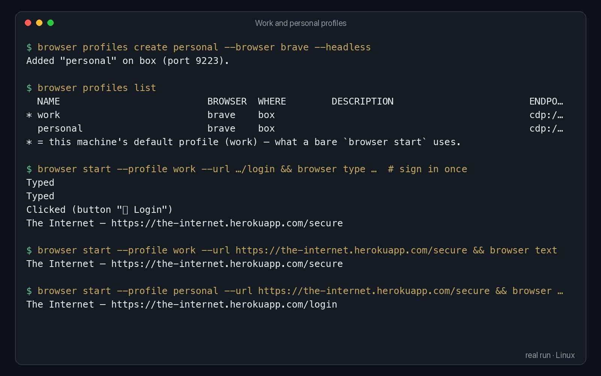</picture></a>
</td>
</tr>
<tr>
<td width="50%" valign="middle">

### Research papers and sources

Search, open the source and pull out the numbers that matter. `text --grep` and `text --css` keep a long paper to a few lines.

[Docs →](docs/use-cases/research.md)

</td>
<td width="50%">
  <a href="docs/use-cases/research.md"><picture><source srcset="docs/assets/readme-features/research.webp" type="image/webp">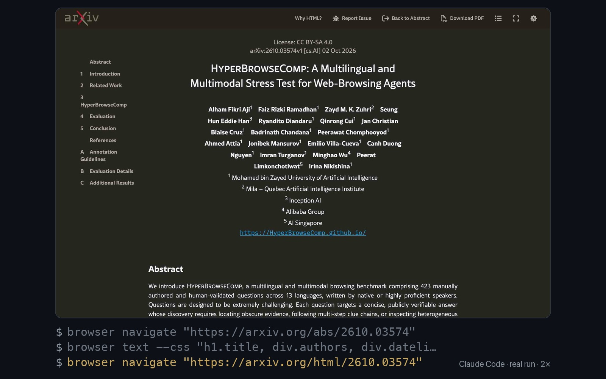</picture></a>
</td>
</tr>
<tr>
<td width="50%" valign="middle">

### Check a page on a phone

Emulate an iPhone, iPad or any viewport, reload and screenshot, to check the layout your users see.

[Docs →](docs/use-cases/check-on-a-phone.md)

</td>
<td width="50%">
  <a href="docs/use-cases/check-on-a-phone.md"><picture><source srcset="docs/assets/readme-features/check-on-a-phone.webp" type="image/webp">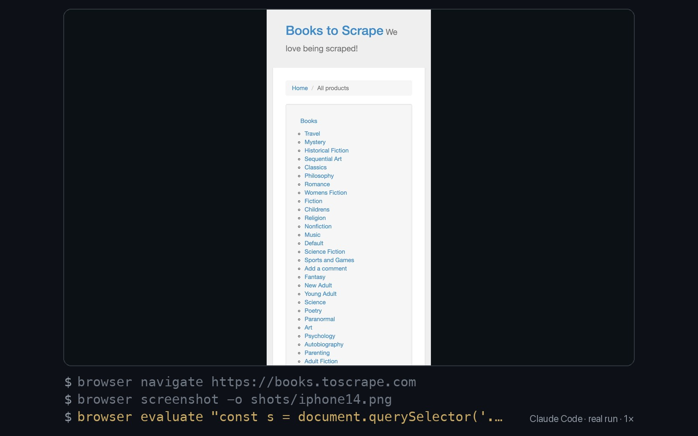</picture></a>
</td>
</tr>
<tr>
<td width="50%" valign="middle">

### Download files

Pick a folder, click the link and wait until the file is on disk, then open it. The agent gets the real path back.

[Docs →](docs/use-cases/download-files.md)

</td>
<td width="50%">
  <a href="docs/use-cases/download-files.md"><picture><source srcset="docs/assets/readme-features/download-files.webp" type="image/webp">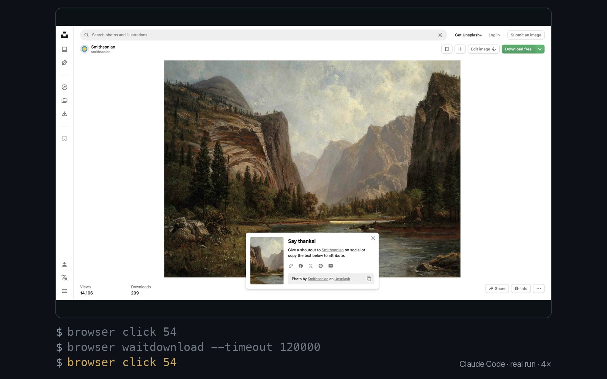</picture></a>
</td>
</tr>
<tr>
<td width="50%" valign="middle">

### Keep proof of what it did

Recordings, PDFs and screenshots are saved per task, and `browser sessions` lists them, so you can check the work.

[Docs →](docs/use-cases/keep-proof.md)

</td>
<td width="50%">
  <a href="docs/use-cases/keep-proof.md"><picture><source srcset="docs/assets/readme-features/keep-proof.webp" type="image/webp">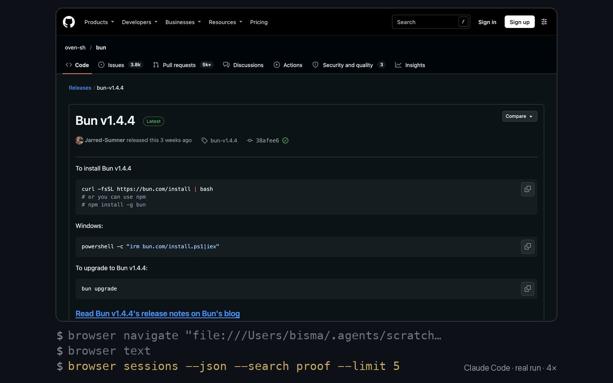</picture></a>
</td>
</tr>
<tr>
<td width="50%" valign="middle">

### Fill forms and check out

Type into fields by their label, pick options and click by name. Each action waits for the page to settle, so steps chain.

[Docs →](docs/use-cases/fill-forms-and-check-out.md)

</td>
<td width="50%">
  <a href="docs/use-cases/fill-forms-and-check-out.md"><picture><source srcset="docs/assets/readme-features/fill-forms-and-check-out.webp" type="image/webp">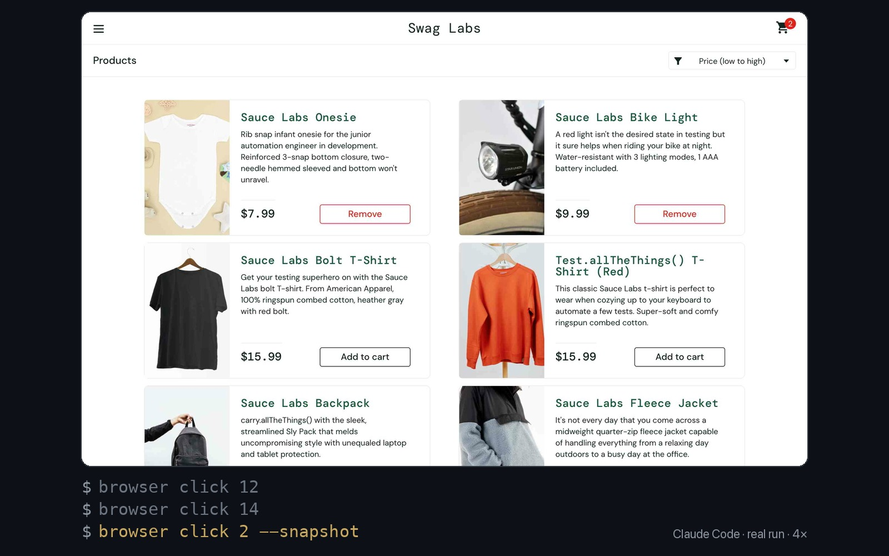</picture></a>
</td>
</tr>
<tr>
<td width="50%" valign="middle">

### Use the sites you are signed into

Sign in once and your agent works in that session: HR, CRM and admin tools, including ones with no API or MCP server.

[Docs →](docs/use-cases/signed-in-sites.md)

</td>
<td width="50%">
  <a href="docs/use-cases/signed-in-sites.md"><picture><source srcset="docs/assets/readme-features/signed-in-sites.webp" type="image/webp">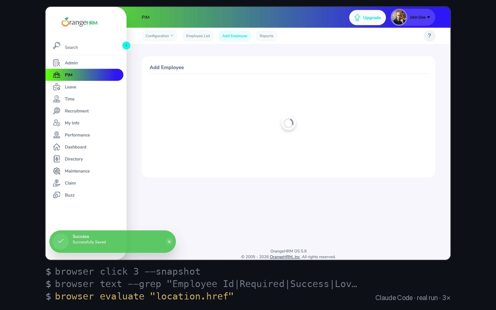</picture></a>
</td>
</tr>
<tr>
<td width="50%" valign="middle">

### Several agents, one browser

Every `browser start` opens a task that owns its tabs, so several agents share one signed-in browser without touching each other's pages.

[Docs →](docs/use-cases/several-agents.md)

</td>
<td width="50%">
  <a href="docs/use-cases/several-agents.md"><picture><source srcset="docs/assets/readme-features/several-agents.webp" type="image/webp">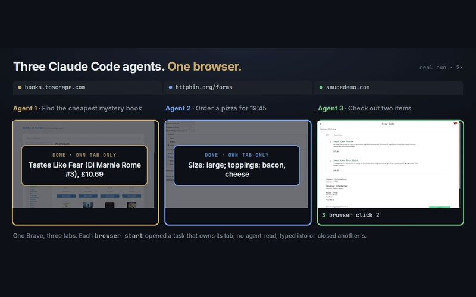</picture></a>
</td>
</tr>
<tr>
<td width="50%" valign="middle">

### Design in Figma

In canvas apps the agent works the way a person does: shortcuts, clicks at a position, and the properties panel by label.

[Docs →](docs/use-cases/design-in-figma.md)

</td>
<td width="50%">
  <a href="docs/use-cases/design-in-figma.md"><picture><source srcset="docs/assets/readme-features/design-in-figma.webp" type="image/webp">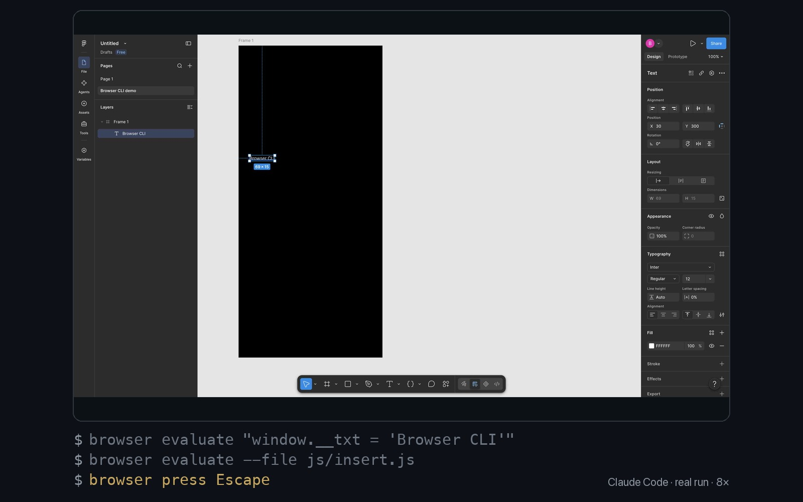</picture></a>
</td>
</tr>
</table>

Each clip is a real run recorded with Browser CLI, sped up; the page for each shows the task, the commands and what came back.

## Benchmark

<picture>
  <source media="(prefers-color-scheme: dark)" srcset="docs/assets/benchmark-dark.svg">
  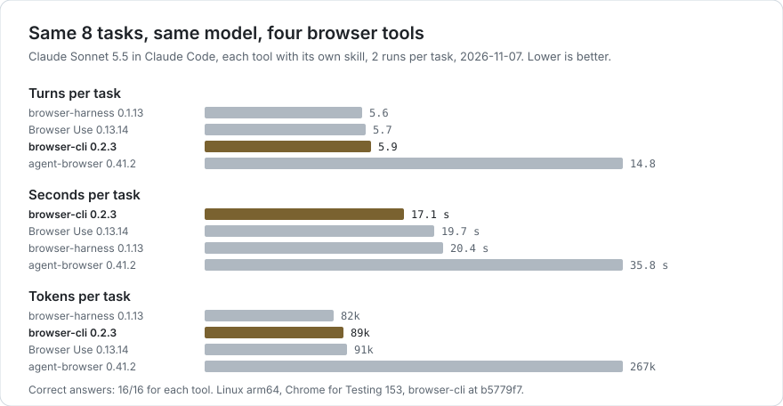
</picture>

- **Browser CLI 0.2.3 was the fastest and cheapest of the four:** 17.1 s and $0.047 per task, against 19.7 s and $0.058 for Browser Use and 20.4 s and $0.050 for browser-harness.
- **browser-harness took the fewest turns and tokens:** 5.56 turns and 82k tokens per task, against 5.69 and 91k for Browser Use and 5.88 and 89k for Browser CLI.
- **agent-browser took about 2.5 times the turns and 3 times the tokens.** Part of that is the benchmark's rules: Claude Code refused 36 of its commands (16 of them its skill's `S=$(agent-browser session id …)` line, most of the rest other shell assignments and pipes), because only the tool's own command is allowed in Bash.
- **All 16 runs correct** for every tool.
- **Earlier runs, from 2026-10-19,** including Browser Use's own Browser Use Bench v2.1, used a script that is not in this repository: [archive](docs/benchmarks/archive-2026-10-19.md).

Run on 2026-11-07 on Linux arm64 with Chrome for Testing 153.0.8010.36: [Browser CLI 0.2.3](https://www.npmjs.com/package/@phnx-labs/browser-cli/v/0.2.3), [Browser Use 0.13.14](https://pypi.org/project/browser-use/0.13.14/), [browser-harness 0.1.13](https://pypi.org/project/browser-harness/0.1.13/), [agent-browser 0.41.2](https://www.npmjs.com/package/agent-browser/v/0.41.2). Browserbase `browse` was not in this run; its 2026-10-19 numbers are in the [archive](docs/benchmarks/archive-2026-10-19.md). Each run's record (grade, answer, turns, seconds, tokens, cost) is in [`bench/results/2026-11-07/`](bench/results/2026-11-07/); the transcripts are not. [`bench/`](bench/README.md) reruns it.

<details>
<summary>Method and per-task results</summary>

Claude Sonnet 5.5 ran each task headless in Claude Code 2.1.301 with one tool and that tool's own shipped skill, against a fresh headless Chrome for Testing for every run, two runs per task, the four tools interleaved, using [`bench/`](bench/README.md) at b5779f7. Model spend for the whole run, including the several-agents test, was $5.94.

Each cell gives the two runs' turns, their mean seconds and their mean tokens; tokens count input, including cached context, plus output. Wall-clock time is mostly the model thinking between turns, so it varies more between runs than turns and tokens do. With two runs per task, read single rows as a direction.

| Task |  Browser CLI |  browser-harness |  Browser Use |  agent-browser |
| --- | --- | --- | --- | --- |
| Shop: cheapest five-star Mystery book across pages | 5 / 5 turns, 14 s, 67k | 4 / 4 turns, 12 s, 52k | 4 / 5 turns, 13 s, 64k | 7 / 10 turns, 22 s, 133k |
| Form: pizza order with radios, checkboxes and a time input | 5 / 5 turns, 14 s, 67k | 5 / 5 turns, 15 s, 72k | 5 / 5 turns, 13 s, 76k | 13 / 12 turns, 27 s, 240k |
| GitHub: latest Bun release tag, asset count, file size | 4 / 4 turns, 11 s, 49k | 9 / 7 turns, 28 s, 130k | 7 / 6 turns, 22 s, 108k | 15 / 14 turns, 37 s, 247k |
| Saucedemo: log in, sort, add two items, check out | 6 / 6 turns, 20 s, 86k | 7 / 6 turns, 25 s, 102k | 8 / 6 turns, 24 s, 122k | 26 / 25 turns, 71 s, 588k |
| Webscraper: most expensive laptop across ~20 pages | 5 / 6 turns, 18 s, 77k | 4 / 6 turns, 20 s, 70k | 5 / 6 turns, 21 s, 85k | 33 / 12 turns, 46 s, 294k |
| Demoblaze: add two phones to the cart and place the order | 10 / 8 turns, 30 s, 141k | 6 / 7 turns, 34 s, 99k | 9 / 6 turns, 40 s, 132k | 15 / 18 turns, 44 s, 347k |
| Instagram: a public profile's name and follower count | 5 / 4 turns, 10 s, 57k | 4 / 4 turns, 16 s, 51k | 4 / 5 turns, 12 s, 64k | 8 / 8 turns, 18 s, 127k |
| Wikipedia: population of the 2022 World Cup winner's capital | 6 / 10 turns, 20 s, 166k | 5 / 6 turns, 14 s, 81k | 5 / 5 turns, 13 s, 75k | 8 / 12 turns, 22 s, 159k |
| **Mean per task** | **5.9 turns, 17.1 s, 89k** | **5.6 turns, 20.4 s, 82k** | **5.7 turns, 19.7 s, 91k** | **14.8 turns, 35.8 s, 267k** |

</details>

## Several agents, one browser

Two agents, one browser. Page commands act only on the task's own tabs:

```console
$ browser start --task shop --url https://books.toscrape.com
$ browser start --task form --url https://httpbin.org/forms/post

$ browser tabs --task shop
TAB         URL
eea868ea    https://books.toscrape.com/ *

$ browser text --task shop --tab f9060fe5        # the form agent's tab
Tab "f9060fe5" not found
```

We ran three Claude Code agents at once in one browser, each told to "work only in tabs you opened yourself", two trials per tool on 2026-11-07 ([method](docs/benchmarks/README.md#several-agents-one-browser), [records](bench/results/2026-11-07/isolation/), [harness to rerun it](bench/README.md)):

<picture>
  <source media="(prefers-color-scheme: dark)" srcset="docs/assets/crossed-tabs-dark.svg">
  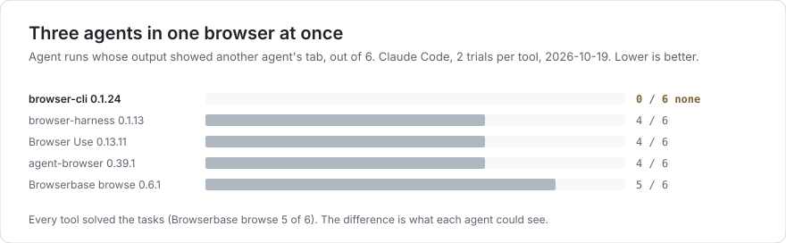
</picture>

| Tool | Tasks solved | Agent runs whose output showed another agent's tab | Time for all three |
| --- | --- | --- | --- |
|  **Browser CLI 0.2.3** | **6 / 6** | **0 / 6** | 86 s, 80 s |
|  browser-harness 0.1.13 | 6 / 6 | 6 / 6: `list_tabs()` lists every agent's tab | 28 s, 26 s |
|  Browser Use 0.13.14 | 6 / 6 | 4 / 6: the same `list_tabs()` | 30 s, 38 s |
|  agent-browser 0.41.2 | 6 / 6 | 6 / 6: `tab` lists every agent's tab, even with `--session` | 64 s, 44 s |

Browser CLI was the slowest here. Its checkout agent took 80 to 86 s at 6 turns, against 20 s for the same task run alone, and the form agent 54 to 55 s against 14 s; the records do not show where that time went.

browser-harness documents the limit itself: "Two agents that switch tabs and act simultaneously can race" ([SKILL.md](https://github.com/browser-use/browser-harness/blob/b41bfb643e6c0f5a879b389615dcd1ee8c6bc165/SKILL.md?plain=1#L72-L73)). agent-browser ran without its opt-in `--pin-tab`. Browserbase `browse` was not in this run; its 2026-10-19 result (5 / 6) is in the [archive](docs/benchmarks/archive-2026-10-19.md#several-agents-one-browser).

## How it compares

Every cell links to the line in that tool's own docs or source it comes from, read on 2026-11-07.

| Tool | Several agents in one browser | Another machine | Your signed-in browser |
| --- | --- | --- | --- |
|  **Browser CLI** | **each task owns its tabs** ([above](#several-agents-one-browser)) | **over SSH** (`start --device`), Chromium-family | yes, any profile you create ([profiles](docs/guide/profiles.md)) |
|  browser-harness | one current tab per daemon; "two agents … can race" ([SKILL.md](https://github.com/browser-use/browser-harness/blob/b41bfb643e6c0f5a879b389615dcd1ee8c6bc165/SKILL.md?plain=1#L67-L80)) | any CDP URL ([daemon.py](https://github.com/browser-use/browser-harness/blob/b41bfb643e6c0f5a879b389615dcd1ee8c6bc165/src/browser_harness/daemon.py#L264-L270)) | attaches after Chrome's Allow dialog ([README](https://github.com/browser-use/browser-harness/blob/b41bfb643e6c0f5a879b389615dcd1ee8c6bc165/README.md?plain=1#L50)) |
|  agent-browser | separate browser per `--session`; in one shared Chrome, opt-in `--pin-tab` ([sessions](https://github.com/vercel-labs/agent-browser/blob/d44f6989bf5e9a9a1c6dd6d97175f8c33b138eca/docs/content/docs/sessions.mdx?plain=1#L73-L84)) | any `ws(s)://` CDP URL ([cdp-mode](https://github.com/vercel-labs/agent-browser/blob/d44f6989bf5e9a9a1c6dd6d97175f8c33b138eca/docs/content/docs/cdp-mode.mdx?plain=1#L25-L34)) | copies your profile, or attaches ([sessions](https://github.com/vercel-labs/agent-browser/blob/d44f6989bf5e9a9a1c6dd6d97175f8c33b138eca/docs/content/docs/sessions.mdx?plain=1#L88)) |
|  Browserbase `browse` | separate browser per `--session` ([README](https://github.com/browserbase/stagehand/blob/310957518a931c1a84c5968b13282cc30acd1be9/packages/cli/README.md?plain=1#L48)) | any CDP URL ([README](https://github.com/browserbase/stagehand/blob/310957518a931c1a84c5968b13282cc30acd1be9/packages/cli/README.md?plain=1#L62)) | `--auto-connect` to local Chrome ([README](https://github.com/browserbase/stagehand/blob/310957518a931c1a84c5968b13282cc30acd1be9/packages/cli/README.md?plain=1#L61)) |
|  Playwright CLI | separate browser per `-s` session ([sessions](https://github.com/microsoft/playwright-cli/blob/4bc00fb7fa5b4329f2fb53ac4743a066c2c664e8/skills/playwright-cli/references/session-management.md?plain=1#L22-L30)) | any CDP URL or Playwright server ([README](https://github.com/microsoft/playwright-cli/blob/4bc00fb7fa5b4329f2fb53ac4743a066c2c664e8/README.md?plain=1#L488-L505)) | attach after Chrome's toggle, or the extension ([sessions](https://github.com/microsoft/playwright-cli/blob/4bc00fb7fa5b4329f2fb53ac4743a066c2c664e8/skills/playwright-cli/references/session-management.md?plain=1#L116)) |
|  Playwright MCP | extension: a tab group per client ([extension](https://github.com/microsoft/playwright/blob/07c7069cdbb1f5c7331d3f4d2abd864dcfde745a/packages/extension/README.md?plain=1#L41-L43)) | any CDP URL or Playwright server ([README](https://github.com/microsoft/playwright-mcp/blob/404be8eb89abecff77a55152b6d843d140c78372/README.md?plain=1#L416-L417)) | through the extension ([extension](https://github.com/microsoft/playwright/blob/07c7069cdbb1f5c7331d3f4d2abd864dcfde745a/packages/extension/README.md?plain=1#L5)) |
|  Chrome DevTools MCP | page IDs per session, but any session can close any page ([McpContext.ts](https://github.com/ChromeDevTools/chrome-devtools-mcp/blob/0b37364dc0a88a804c6d73d3335e776adc7f33c4/src/McpContext.ts#L606-L613)) | any CDP URL ([configuration](https://github.com/ChromeDevTools/chrome-devtools-mcp/blob/0b37364dc0a88a804c6d73d3335e776adc7f33c4/docs/configuration.md?plain=1#L72-L81)) | `--autoConnect` after an Allow dialog, Chrome 144+ ([configuration](https://github.com/ChromeDevTools/chrome-devtools-mcp/blob/0b37364dc0a88a804c6d73d3335e776adc7f33c4/docs/configuration.md?plain=1#L67-L68)) |
|  Claude in Chrome | a tab group per session ([docs](https://code.claude.com/docs/en/chrome)) | not documented | yes, through the extension ([docs](https://code.claude.com/docs/en/chrome)) |
|  Playwriter | tab groups are cosmetic; tabs are shared across sessions ([sessions](https://github.com/remorses/playwriter/blob/2cae912a9c1e68ae2b74fcaef9efd79b6d7d432f/website/src/pages/docs/sessions.mdx?plain=1#L46-L48)) | `playwriter serve` over a LAN or tunnel ([README](https://github.com/remorses/playwriter/blob/2cae912a9c1e68ae2b74fcaef9efd79b6d7d432f/README.md?plain=1#L345-L363)) | yes, extension with no dialog ([README](https://github.com/remorses/playwriter/blob/2cae912a9c1e68ae2b74fcaef9efd79b6d7d432f/README.md?plain=1#L299)) |

Others reach further elsewhere: agent-browser also drives Safari and the iOS Simulator and has five cloud providers built in; Playwright drives Firefox and WebKit; Playwriter and Browserbase have their own clouds.

## Remote browsers

First run `browser remote-control on` on the other machine, with Browser CLI installed there; remote control is off by default. Then:

```sh
browser start --device box --profile work    # box is a Host in ~/.ssh/config
browser navigate https://example.com         # later commands follow the task there
```

One kept-alive SSH connection carries the session. Remote control is Chromium-family only; Firefox and Arc run on the local machine. More in [Remote browsers](docs/guide/remote.md).

## Security and privacy

- **An agent with `browser` acts as you.** It can read and click anything your signed-in profile can. Give it a dedicated profile (`browser profiles create agent --browser chrome`) when it should not see your personal accounts. There is no URL allowlist yet.
- **Nothing leaves your machine.** No telemetry. It talks to your browser's local DevTools port, Firefox's BiDi port or Arc's Apple Events, and to the machines you name in your own SSH config. The one exception: the first recording on a machine without ffmpeg downloads it ([SECURITY.md](SECURITY.md)).
- **What ships.** npm installs one compiled binary per platform. The [release workflow](.github/workflows/release.yml) publishes, with npm provenance, the packages main CI built and tested for that commit. It authenticates with an npm token kept in the `npm-publish` GitHub environment, which only `release/*` branches can use.

## Docs

- [Use cases](docs/use-cases/README.md), each with a recorded run
- Guide: [Getting started](docs/guide/getting-started.md), [Driving a page](docs/guide/driving-a-page.md), [Profiles](docs/guide/profiles.md), [Remote browsers](docs/guide/remote.md), [The agent skill](docs/guide/agent-skill.md), [Platforms and troubleshooting](docs/guide/troubleshooting.md), [History and logs](docs/guide/history-and-logs.md)
- [Command reference](docs/command-index.md)
- [Benchmarks](docs/benchmarks/README.md) and [`bench/`](bench/README.md)
- [Development](docs/development.md), [Contributing](CONTRIBUTING.md), [Security](SECURITY.md)

Browser CLI is built by [Phoenix](https://phoenix.so/browser-cli?ref=github) ([why we open-sourced it](https://phoenix.so/blog/browser-cli?ref=github)). Apache-2.0.
