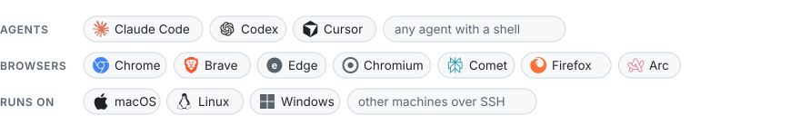
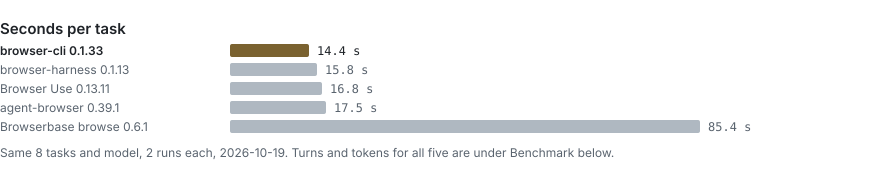
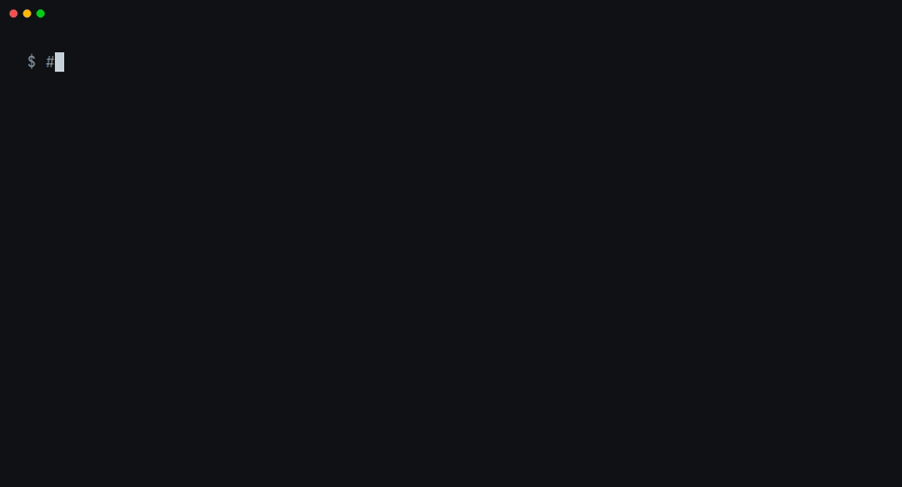
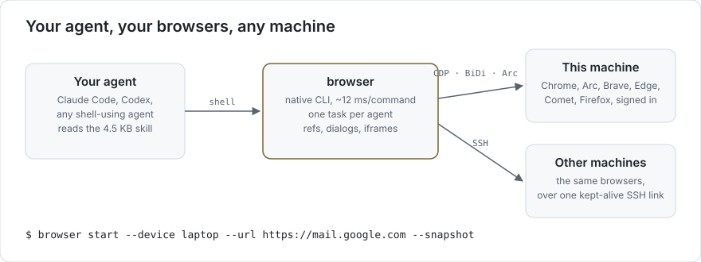

<div align="center">

# browser-cli

**Let your coding agent use the browsers you're already signed into.**<br>
Chrome, Arc, Brave, Edge, Comet or Firefox, on this machine or another one over SSH.

[](https://www.npmjs.com/package/@phnx-labs/browser-cli)
[](https://github.com/phnx-labs/browser-cli/actions/workflows/test.yml)
[](LICENSE)

[Install](#install) · [Benchmark](#benchmark) · [How it compares](#how-it-compares) · [Driving a page](#driving-a-page) · [Remote browsers](#remote-browsers) · [Command reference](docs/command-index.md)

</div>

<picture>
  <source media="(prefers-color-scheme: dark)" srcset="docs/assets/works-with-dark.svg">
  
</picture>

<picture>
  <source media="(prefers-color-scheme: dark)" srcset="docs/assets/benchmark-strip-dark.svg">
  
</picture>

## Install

```sh
npm install -g @phnx-labs/browser-cli
npx skills add phnx-labs/browser-cli   # teaches your agents to use it
browser profiles create work --browser chrome   # once: the browser to drive (chrome, brave, edge, chromium, comet, arc)
browser use work                                # the default for a bare `browser start`
```

On a machine with no display, add `--headless` to `profiles create`.

In Claude Code, the skill also installs as a plugin:

```text
/plugin marketplace add phnx-labs/browser-cli
/plugin install browser@browser-cli
```

Or paste this into your agent:

```text
Install browser-cli (npm install -g @phnx-labs/browser-cli) and read its
skill (browser skills path). Then open news.ycombinator.com in my browser
and summarize the top 5 stories.
```

<p align="center">
  
</p>

## Why browser-cli

<picture>
  <source media="(prefers-color-scheme: dark)" srcset="docs/assets/how-it-works-dark.svg">
  
</picture>

- **Your own browsers, signed in.** It drives the Chrome, Brave, Edge, Comet,
  Firefox or Arc profile you already use, cookies and logins included, instead
  of a fresh headless browser that sites block and that has no sessions.
- **Fewer turns for the agent.** Every action returns once the page has settled,
  and `--snapshot` prints the page it left, so known steps chain in one shell
  call with no task id to pass. `start --snapshot` lists the first page, and `click --text
  "Checkout"` clicks by name. A ref keeps naming its element when a count in its
  label changes ("Cart, empty" to "Cart, 2 items"), and refs reach into iframes.
- **It does not stall where pages do.** Alerts are answered and reported instead
  of freezing the tab, a `confirm()` comes back as a question for `browser
  dialog`, router navigations are listed once the new page is drawn, date and
  time inputs take "19:45", and off-screen elements are scrolled into view.
- **Cheap turns.** The shipped skill is about 7 KB and command output is
  short, so each agent turn carries less context.
- **Agents share a browser safely.** Each task owns its tabs, so several agents can work in one signed-in browser at once; see [Several agents, one browser](#several-agents-one-browser).
- **Remote browsers.** `start --device <machine>` binds a task to a browser on
  another machine; later commands follow it there over one kept-alive SSH
  connection.
- **A native binary.** `browser --version` takes about 16 ms; the service keeps one session
  per task, with its own tabs, screenshots, recordings and network capture.

## Benchmark

<picture>
  <source media="(prefers-color-scheme: dark)" srcset="docs/assets/benchmark-dark.svg">
  
</picture>

- **Fastest of the five:** 14.4 s per task, against 15.8 s for browser-harness and 16.8 s for Browser Use.
- **Fewest tokens and lowest cost:** 97k tokens and $0.041 per task, against 102k and $0.044 for Browser Use and 105k and $0.046 for browser-harness.
- **Turns are level with Browser Use:** 4.5 per task against 4.4; browser-harness takes 4.7. agent-browser and Browserbase's `browse` take about twice the turns and 2.5 to 3 times the tokens.
- **All 16 runs correct** for browser-cli, Browser Use and agent-browser; browser-harness and `browse` missed one each.
- **On Browser Use Bench v2.1**, Browser Use's own benchmark of long research tasks, browser-cli was 2.2 times as fast as Browser Use (90 s against 202 s per task), 7% cheaper, and scored 45.4 to its 43.6 with the benchmark's own rubric judge. browser-harness scored higher (50.4) at 220 s. Four tasks, 16 runs per tool: [docs/benchmarks.md](docs/benchmarks.md).

<details>
<summary>Method and every run</summary>

Claude Sonnet 5.5 ran each task headless in Claude Code with one tool and that
tool's own shipped skill, on macOS against a fresh headless Chrome for Testing
153, two runs per task, on 2026-10-19 (trials 11 and 12, run in turn). The versions were:

- browser-cli 0.1.33
- Browser Use 0.13.11 (its CLI runs on browser-harness)
- browser-harness 0.1.13
- agent-browser 0.39.1
- Browserbase `browse` 0.6.1

Each cell gives the two runs' turns and their mean tokens; tokens count input,
including cached context, plus output. Wall-clock time is mostly the model
thinking between turns, so it varies more between runs than turns and tokens do.
With two runs per task, read single rows as a direction. One `browse` Demoblaze run took 810 s and 28 turns without an answer, which carries most of its 85.4 s mean. One browser-cli run that found the benchmark's Chrome not running was set aside and run again; no other run hit that.

| Task |  browser-cli |  Browser Use |  browser-harness |  agent-browser |  browse |
| --- | --- | --- | --- | --- | --- |
| Shop: cheapest five-star Mystery book across pages | 5 / 3 turns, 85k | 4 / 4 turns, 92k | 5 / 6 turns, 128k | 8 / 11 turns, 247k | 4 / 5 turns, 95k |
| Form: pizza order with radios, checkboxes and a time input | 3 / 3 turns, 64k | 4 / 3 turns, 81k | 3 / 3 turns, 69k | 8 / 7 turns, 247k | 8 / 10 turns, 234k |
| GitHub: latest Bun release tag, asset count, file size | 7 / 7 turns, 152k | 6 / 6 turns, 134k | 4 / 6 turns, 119k | 8 / 4 turns, 196k | 6 / 8 turns, 175k |
| Saucedemo: log in, sort, add two items, check out | 5 / 5 turns, 108k | 7 / 5 turns, 150k | 5 / 7 turns, 144k | 10 / 9 turns, 320k | 11 / 12 turns, 306k |
| Webscraper: most expensive laptop across ~20 pages | 5 / 5 turns, 108k | 8 / 6 turns, 152k | 6 / 6 turns, 115k | 9 / 9 turns, 248k | 19 / 7 turns, 439k |
| Demoblaze: add two phones to the cart and place the order | 5 / 6 turns, 118k | 5 / 4 turns, 104k | 4 / 10 turns, 153k | 29 / 8 turns, 421k | 17 / 28 turns, 674k |
| Instagram: a public profile's name and follower count | 2 / 3 turns, 52k | 2 / 2 turns, 45k | 3 / 2 turns, 56k | 5 / 5 turns, 128k | 6 / 7 turns, 148k |
| Wikipedia: population of the 2022 World Cup winner's capital | 4 / 4 turns, 88k | 3 / 2 turns, 57k | 2 / 3 turns, 56k | 5 / 5 turns, 145k | 5 / 5 turns, 117k |
| **Mean per task** | **4.5 turns, 14.4 s, 97k** | **4.4 turns, 16.8 s, 102k** | **4.7 turns, 15.8 s, 105k** | **8.8 turns, 17.5 s, 244k** | **9.9 turns, 85.4 s, 273k** |

</details>

## Several agents, one browser

Each `browser start` opens a task that owns its tabs. Page commands such as `refs`, `text`, `click` and `type` act only on that task's tabs, and `done` closes only the tabs it opened. So several agents can work in one signed-in browser at once without reading, typing into or closing each other's pages.

To test it, three Claude Code agents ran at the same time in one browser: one browsed a shop across pages, one filled a pizza-order form, and one completed a checkout ([method](docs/benchmarks.md#several-agents-one-browser)). Every agent was told: "Work only in tabs you opened yourself." Each tool ran this twice, six agent runs per tool, on 2026-10-19. A run counts as showing another agent's tab when a script found another agent's site in that agent's tool output.

| Tool | Tasks solved | Agent runs whose output showed another agent's tab | Time for all three |
| --- | --- | --- | --- |
|  **browser-cli 0.1.24** | **6 / 6** | **0 / 6** | 25 s, 49 s |
|  browser-harness 0.1.13 | 6 / 6 | 4 / 6: `list_tabs()` lists every agent's tab | 41 s, 32 s |
|  Browser Use 0.13.11 | 6 / 6 | 4 / 6: the same `list_tabs()` | 36 s, 41 s |
|  agent-browser 0.39.1 | 6 / 6 | 4 / 6: `tab` lists every agent's tab, even with `--session` | 136 s, 56 s |
|  Browserbase browse 0.6.1 | 5 / 6 | 5 / 6: in one run the shop agent read the form agent's page and answered wrong | 85 s, 70 s |

browser-cli 0.1.23 leaked once (1 / 6). Several agents that ran `start` at the same moment raced to open the browser connection, and one agent's task was dropped; its "not found" error listed the other agents' tasks. 0.1.24 fixes the race, and the row above is 0.1.24.

browser-harness documents the limit itself: one daemon has one shared current tab, and "two agents that switch tabs and act simultaneously can race".

## How it compares

| Tool | Several agents in one browser | Another machine | Browsers | Your signed-in browser | Cloud |
| --- | --- | --- | --- | --- | --- |
| <br>**browser-cli** | **yes: each task owns its tabs** | **yes, over SSH** (`start --device`), Chromium-family | Chrome, Brave, Edge, Chromium, Comet, Firefox, Arc | yes, per profile | a `ws://` or `wss://` CDP URL (`--endpoint`) |
| <br>browser-harness, Browser Use | no: one shared tab per daemon; its docs say simultaneous agents race and suggest a cloud browser per agent | any CDP URL, no SSH | Chrome, Chromium | yes (Chrome 144 Allow dialog) | Browser Use Cloud (key), any CDP URL |
| <br>agent-browser | opt-in `--session` and `--pin-tab` | any CDP URL | Chrome, Brave, Chromium, Lightpanda, Safari (`-p safari`, safaridriver), iOS Simulator Safari | copied profile, or attach | 5 providers built in (keys), any `wss://` |
| <br>Browserbase `browse` | a session is a separate browser | any CDP URL | Chromium | attach to local Chrome | Browserbase (key), any `ws(s)://` |
| <br>Playwright MCP | extension: a tab group per client | any CDP URL | Chromium, Playwright's Firefox and WebKit | via extension | any CDP URL |
| <br>Chrome DevTools MCP | page ids, but `close_page` takes any id | any CDP URL | Chrome | Chrome 144 auto-connect | any CDP URL + headers |
| <br>Claude in Chrome | a tab group per session | no | Chrome, Edge | yes (extension) | no |
| <br>Playwriter | a tab group per session | no (its tunnel lets a remote agent drive your browser) | Chrome, Brave | yes (extension, no dialog) | no |

Read from each tool's source at a pinned commit and its docs on 2026-10-19 ([how](docs/benchmarks.md#how-it-compares)). browser-cli is the only one that combines per-task tab ownership with Chromium-family browsers on your own other machines over SSH; its Firefox and Arc profiles run on the local machine. Others reach further elsewhere: agent-browser drives Safari and the iOS Simulator and has five cloud providers built in.

## Security and privacy

- **An agent with `browser` acts as you.** It can read and click anything your
  signed-in profile can. Give it a dedicated profile (`browser profiles create
  work --browser chrome`) when it should not see your personal accounts.
- **Nothing leaves your machine.** browser-cli sends no telemetry. It talks to
  your browser's local DevTools port, Firefox's BiDi port or Arc's Apple Events,
  and to the machines you name over your own SSH config.
- **What ships.** npm installs one compiled binary per platform, published from
  this repository's release workflow through npm trusted publishing (OIDC), so
  no npm token exists to leak.

## First run

```sh
browser profiles create work --browser chromium
browser start --profile work --url https://example.com   # prints the task name, e.g. 3f2a9c1d
browser screenshot -o shot.png --task 3f2a9c1d
browser done --task 3f2a9c1d
```

`start` launches (or attaches to) the browser for a profile and opens a **task** —
a named browsing context with its own tabs and capture ledger. Page verbs like
`navigate` and `screenshot` attach to that task: they resolve the caller's live
task, or take `--task <id>` to pick one explicitly. `done` closes the task's
tabs; `browser stop` stops the whole service.

Run `browser --help` for the full verb list and `browser <verb> --help` for its
options.

## Driving a page

The loop an agent runs: list what it can act on, act, read the result.

```sh
browser start --url https://example.com --snapshot   # task name, then the page's refs
browser refs                               # numbered interactive elements
browser text                               # title, URL and the readable text
browser click 3 --snapshot                 # act, then print the page it left
browser click --text "Checkout"            # by accessible name, optionally --role button
browser type 5 "ada@example.com"           # text positionally, or --text
browser type "Email" "ada@example.com"     # or name the field by its label
browser type 9 "19:45"                     # date and time inputs take their value
browser select 7 "Large"                   # a <select> option by label or value
browser press Enter --snapshot
browser dialog accept                      # or dismiss: answers a confirm() or prompt()
browser navigate https://shop.example/p/1 && browser click --text "Add to cart" && browser text
```

- **Refs** are numbers from the latest listing. Add `--snapshot` to `start`,
  `click`, `type`, `select` and `press`: it prints the new URL, title and refs
  in the same call. Every action returns once the page has settled (Chrome-family
  browsers; `--no-wait` returns as it lands), so steps chain with `&&`. A ref keeps naming its element while that element is on
  the page, even when a number in its label changes; one that drifted is
  re-matched by role and name before the action, within the same frame.
- **Dialogs.** An `alert()` or leave-page prompt is accepted and printed. A
  `confirm()` or `prompt()` waits: the action that raised it prints the
  question, and `browser dialog accept|dismiss` answers it.
- **iframes.** In Chromium-family browsers, `refs` lists elements inside
  same-site and cross-site iframes under an `- iframe "<url>"` line, and
  `click`, `type`, `hover` and `select` act on them; `text` reads them too.
  One level of frames below the page is covered. `upload` into a cross-site
  iframe is refused with the frame's URL.
- **Off-screen elements** are scrolled into view before a click or hover.
- **Pages without usable refs** (canvas apps, custom widgets): take a
  `screenshot` and click by position with `click --at X,Y`.
- **Many steps in one process:** `browser stream` reads NDJSON requests on
  stdin and keeps one connection to the service open.

## Profiles and endpoints

A **profile** names a browser, where it runs, and how to reach it. Profiles are
stored under `~/.agents/browser/profiles/<machine>.yaml`, or
`~/.agents/browser/local/profiles.yaml` for ones only this machine sees.

```sh
browser profiles create work --browser chrome            # local Chrome, auto-assigned CDP port
browser profiles create hl --browser chromium --headless # headless Chromium
browser profiles list
browser profiles logins          # signed-in services and accounts per profile
browser profiles logins --json   # [{"profile","service","account"} | {"profile","service":null,"account":null,"unread"}]
```

`logins` reads each profile's cookie store where its browser keeps it: Arc's
`User Data/<profile dir>`, Comet's own user-data dir, a pinned `userDataDir`,
or the runtime dir browser launched into. A store it cannot read here (a
profile declared on another device, a browser reached over `ssh://`, Firefox,
a profile never launched on this machine) is listed as `(not read: <reason>)`,
and in `--json` as one `{"profile", "service": null, "account": null,
"unread"}` row, so a profile with no rows had its store read and has no live
session.

Each profile resolves to an endpoint:

- `cdp://127.0.0.1:9222` — a Chromium-family browser over the DevTools Protocol.
- `bidi=firefox-bidi://127.0.0.1:9674` — Firefox over WebDriver BiDi.
- `ssh://user@box?port=9222` — a browser on a remote host reached over SSH.

## Remote browsers

Bind a task to a browser on another machine with `--device` on `start`:

```sh
browser start --device box --profile work
browser navigate https://example.com
browser screenshot -o shot.png
```

`--device <alias>` resolves against `~/.ssh/config`, and against an inherited
context descriptor when the CLI runs under agents-cli. browser-cli itself does
not read a fleet registry. Use `--device local` to force the task onto this
machine. The device is bound once at `start`; page verbs run against the task's
bound device, so `--device` is only valid there.

## Agent skill

The package ships the browser skill in the standard Agent Skills layout, so
agents learn the CLI from the version that is installed:

```
skills/browser/
  SKILL.md                    # workflow, defaults, where to look for flags
  references/arc.md           # Arc limits and sharing the user's window
  references/sites/<site>.md  # per-site guides (higgsfield, linkedin, perplexity, slack)
  scripts/slack/*.js          # page scripts the Slack guide runs with evaluate --file
```

```bash
npx skills add phnx-labs/browser-cli    # install into your agents
browser skills path                     # the installed copy (link agents here)
browser skills get arc                  # read one document
browser help --json                     # every command, argument and option
```

The skill lists no flags. Agents read `browser <command> --help` or
`browser help --json`, which always match the installed binary.
`browser start --url` prints the site guide for that host.

## Using it through agents-cli

Agents CLI ships `agents browser` as a thin consumer of this binary. It forwards
every verb unchanged and adds the concerns it owns: fleet device discovery
(`--device` becomes an SSH target), agent-session identity, remote-control
consent, and cross-machine session history. The seam between the two — the
inherited context descriptor, the event stream, and the shared on-disk paths —
is documented in [docs/integration.md](docs/integration.md). The command
reference is [docs/browser.md](docs/browser.md).

## Platform support

| Platform | Architectures |
| --- | --- |
| macOS | arm64, x64 |
| Linux | arm64, x64 |
| Windows | x64 |

Chromium CDP, Firefox BiDi and SSH endpoints work on all three. Native Arc
control is macOS-only. Safari is not supported.

## Troubleshooting

- **Headless on Linux.** A headless Chromium or Brave needs the usual shared
  libraries (fonts, `libnss3`, `libatk`, `libgbm`, and friends). Install your
  distribution's chromium package to pull them in; a missing library shows up as
  the browser process exiting immediately after `start`.
- **"No usable sandbox" in a container.** Chromium's sandbox needs user
  namespaces, which Docker's default seccomp profile blocks, so Chromium exits
  at launch. Run the container with `--security-opt seccomp=unconfined` (or a
  seccomp profile that allows `clone` with `CLONE_NEWUSER`), or run on a host
  or VM. browser-cli does not pass `--no-sandbox` for you.
- **Port already in use.** Each profile binds a debugging port. If `start`
  reports a squatted port, another browser or a stale process holds it — stop it,
  or create the profile with a different `--endpoint`.
- **Comet and Arc.** Comet is driven as a Chromium-family browser over CDP and
  works best as an attach-only profile against a browser you already launched.
  Arc is always attach-only and macOS-only. Its tasks open in an Arc window of
  their own; `screenshot` captures that window through the Computer helper
  (`computer setup`) without bringing Arc forward.
- **Service state.** `browser status` shows whether the IPC service is running
  and lists active tasks. `browser stop` shuts the service down.

## Browse history

`browser sessions` opens a searchable task and capture picker in a terminal.
Use arrows to move, Enter to browse or open a capture, and Escape to go back.
`--no-interactive` keeps the printed listing; `--json` keeps the existing
profile/capture schema. Add `--tasks` for durable task rows, including tasks
without captures, or `--search <text>` to filter those rows.

The same core filters as `sessions` apply to the picker, the printed listing
and `--json`: `--since <when>` / `--until <when>` take `2h`, `7d`, `4w`, `1mo`,
`1y` or an ISO date and keep rows by last activity (capture time in the
profile listing), and an invalid value exits 2. `--limit <n>` caps the printed
listing (default 50); `--json` is unbounded unless `--limit` is given. The
count footer (`Showing 50 of 120 tasks. --limit 120 or --json to see all, …`)
goes to stderr, so piped stdout carries rows only. The picker header names the
active filters.

```bash
browser sessions --since 7d
browser sessions --tasks --since 1mo --until 7d --json
browser sessions --no-interactive --limit 20
```

Browser owns 365-day task summaries in `browser/data/history.db` under
its configured Agents home. Neither Agents nor Sessions needs to be installed.
On first task listing it adopts legacy browser summaries read-only;
`browser sessions migrate [--from /path/to/sessions.db] --json` repeats the
import safely. Captures stay in place and are never deleted by summary retention.
Browser state lives under `~/.agents/browser/` (or `$AGENTS_HOME/browser/`).
Offered profiles sync in `profiles/<device>.yaml`; only that device writes its file.
Private profile declarations use the same name-to-configuration map in
`local/profiles.yaml` and override this machine's offered declarations.
Consent lives in `local/settings.yaml`, outside fleet sync. Runtime sockets and
locks use `run/`, captures and browser caches use `cache/`, kept sign-ins use
`logins/`, and logs use `logs/`. Before running a command, the CLI or daemon
migrates old folders under one exclusive lock. Once complete, subsequent commands
check the local marker and legacy paths without taking migration or Agents config
locks. Recreated legacy folders trigger another migration. If the migration lock
is unavailable, the CLI warns; commands that need no daemon can continue, while
starting a daemon waits for a successful retry. Existing directories merge;
conflicting files are retained under `local/migration-conflicts/` with a warning
naming both copies. History rows merge transactionally, so a fresh database does
not hide old tasks. Tombstone files prevent old binaries from recreating migrated
folders. Live browser stores are left in place: close the named browser and rerun
the command, then restart the service before using that profile.

Logs are JSON lines with a `ts` field, read with `tail` and `jq`. Every request
the CLI sends appends one record (command, task, profile, `ok`, `error`, `ms`) to
`logs/actions/<UTC day>.jsonl`, kept 30 days. The daemon writes launches, closes,
navigations, screenshots, reaper results, lost connections and save failures to
`logs/daemon.jsonl`; a repeated failure is written once, then at its 10th, 100th
and 1000th occurrence with `count`, and starts over after ten quiet minutes. URLs
are logged without credentials, query or fragment, which can carry tokens; a
`data:` or `javascript:` URL is logged as its scheme alone. At
start the daemon rolls a `daemon.jsonl` over 10 MB to `.1`, keeping three.
`logs/browser-service.log` holds only what the daemon prints to stderr, such as
a crash.

```sh
tail -3 ~/.agents/browser/logs/actions/$(date -u +%F).jsonl | jq .
jq -c 'select(.error)' ~/.agents/browser/logs/daemon.jsonl
```

Migration renames only within the selected `AGENTS_HOME`; inherited Agents
cache/history/helper/log overrides cannot move another home's data. `EXDEV`
means the source and destination are on different filesystems: the CLI leaves
the source untouched and names both paths. Stop browsers using that source,
move it by hand into the named destination without overwriting existing files,
and rerun the current CLI. Other move failures also warn without stopping the
service. An old daemon that cannot be identified or stopped is left intact;
status and configuration remain available, but driving is blocked until it is
stopped and the new service is restarted.
During this release, offered profiles are also written to the legacy device file
for older peers; new profile YAMLs take precedence when reading both layouts.

## Development

Building, testing, regenerating the command reference and cutting a release are
in [docs/development.md](docs/development.md). How to send a change is in
[CONTRIBUTING.md](CONTRIBUTING.md); report a vulnerability as described in
[SECURITY.md](SECURITY.md).

browser-cli is built by Phoenix ([phoenix.so](https://phoenix.so)). Rush ([getrush.ai](https://getrush.ai)) is where agents run; browser-cli is one of the tools they use to drive a browser.

## License

[Apache License 2.0](LICENSE). Copyright 2026 Phoenix Horizon, Inc.
