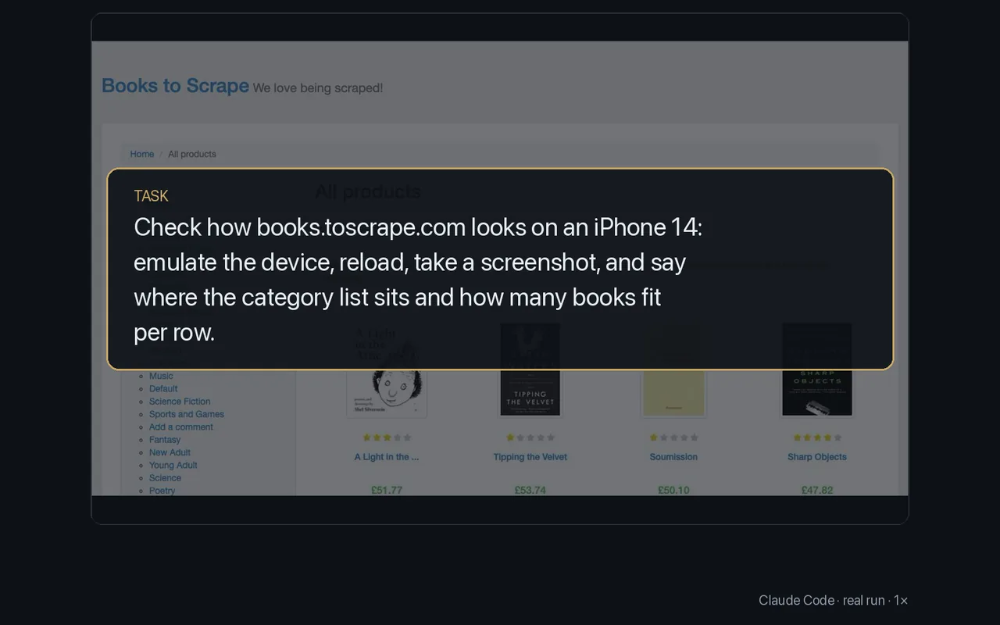

# Check a page on a phone

<p align="center"></p>

Emulate a phone, tablet or any viewport, reload, and screenshot, to check the layout your users see.

Commands from the run that checked Books to Scrape on an iPhone 14:

```sh
browser set device "iPhone 14"
browser navigate https://books.toscrape.com
browser screenshot -o shots/iphone14.png
```

Its answer: at 390 × 844 the category list sits above the books, and two books fit across a row.

- `browser devices` lists the presets; `browser set viewport <width> <height>` sets any size.
- `set device` applies to the task's tab, in Chrome, Brave, Edge and other Chromium-family profiles. Load the page after it, as the run did with `navigate`, so the site lays out for the phone; `screenshot` then captures it at the device's pixel ratio.

More: [Driving a page](../guide/driving-a-page.md).
