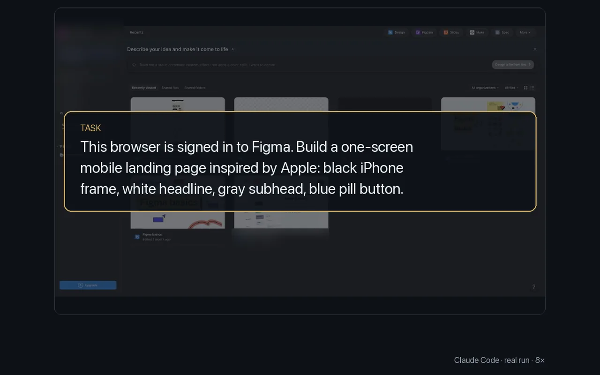

# Design in Figma

<p align="center"></p>

Canvas apps have few clickable elements to list, so the agent works the way a person does: keyboard shortcuts, clicks at a position, and the properties panel by label.

The task, in a browser signed in to Figma: build a one-screen mobile landing page inspired by Apple, with a black iPhone frame, a white headline "browser-cli", a gray subheading and a blue pill-shaped "Get started" button. A sample of the 63 turns:

```sh
browser click --at 700,300            # the canvas
browser press f                       # frame tool
browser type "Width" 393 --clear && browser press Enter
browser type "Height" 852 --clear && browser press Enter
browser type "Color" 000000 --clear && browser press Enter
browser screenshot -o shots/s5.png    # check the result
```

- `screenshot` lets the agent check each step; `click --at X,Y` takes viewport coordinates from that screenshot.
- Fields in a properties panel can be named by their label (`"Width"`, `"Color"`), as in a form.
- The run took 63 turns; the clip is shown at 8x. Account details in the clip are blurred.

More: [Driving a page](../guide/driving-a-page.md).
