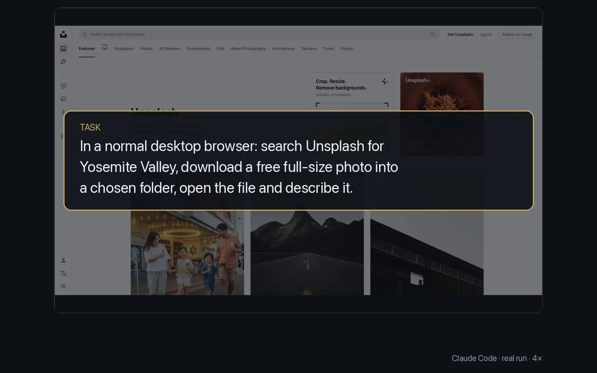

# Download files

<p align="center"></p>

Choose where downloads go, click the link, and wait until the file is on disk. The agent gets the real path back for its next step.

The task: find a free full-size photo of Yosemite Valley on Unsplash, download it, open it and describe it. It ran in a normal desktop browser (Comet). Commands from the run:

```sh
browser download --path …/downloads-img2
browser navigate "https://unsplash.com/s/photos/yosemite-valley"
browser navigate "https://unsplash.com/photos/majestic-mountain-valley-with-a-winding-river-6Nt_6i0ir6c"
browser refs
browser click 54                      # the Download button
browser waitdownload
browser navigate "file:///…/smithsonian-6Nt_6i0ir6c-unsplash.jpg"
browser screenshot
```

Its answer: `smithsonian-6Nt_6i0ir6c-unsplash.jpg`, 2.4 MB, 2984 × 2190 px, a Bierstadt painting of Yosemite Valley.

- `waitdownload` prints `Downloaded: <path>` once the file is complete. Without `browser download --path`, files go to the profile's downloads folder.
- Sites with bot checks, such as Unsplash, work best in a normal, visible profile like the one this run used.

More: [Driving a page](../guide/driving-a-page.md).
