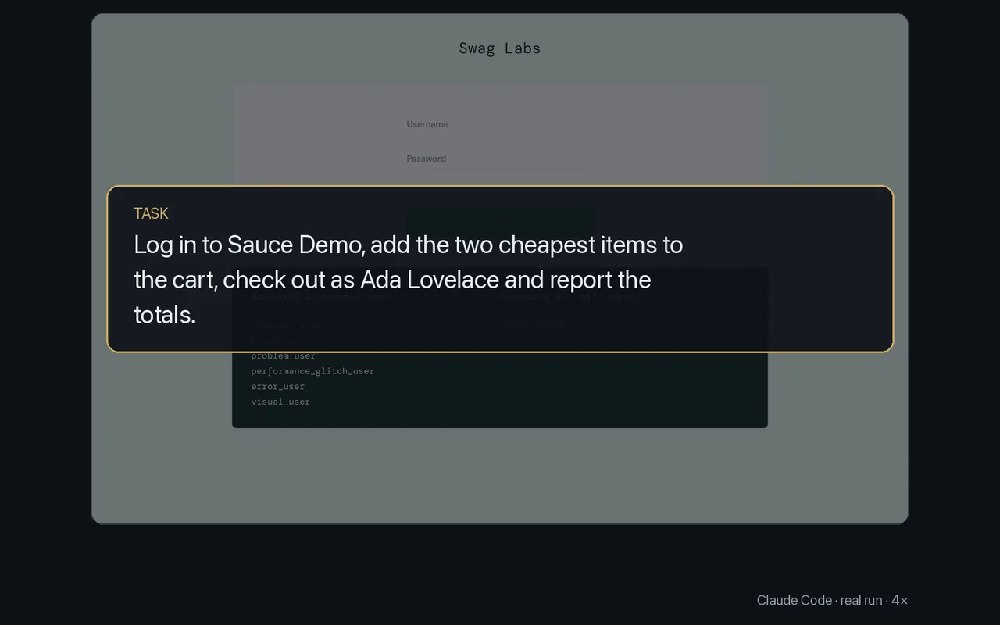

# Fill forms and check out

<p align="center"></p>

Type into fields by their label, pick options and click by name or by the number `--snapshot` lists. Each action returns once the page has settled, so steps chain in one shell call.

The task: log in to Sauce Demo, add the two cheapest items to the cart, check out as Ada Lovelace and report the totals. Commands from the run:

```sh
browser type "Username" standard_user
browser type "Password" secret_sauce
browser click 1 --snapshot                            # Login
browser select 1 "Price (low to high)" --snapshot
browser click 12
browser click 14                                      # the two cheapest
browser click 2 --snapshot                            # cart, then Checkout
browser type 7 Ada
browser type 8 Lovelace
browser type 9 94107
browser click 3 --snapshot                            # Continue
browser text --grep "Item total|Tax|Total"
browser click 2                                       # Finish
```

Its answer: item total $17.98 (Onesie $7.99 and Bike Light $9.99), total $19.42 with $1.44 tax, and the site showed "Thank you for your order!".

- `browser dialog accept|dismiss` answers a `confirm()` or `prompt()`; `browser upload -r <ref> -f <file>` fills a file input.
- To type a password without the agent seeing it, `browser type "Password" --secret <bundle>/<KEY>` reads it from the `secrets` CLI. A bundle named after a site (`stripe.com`) types only into that site.

More: [Driving a page](../guide/driving-a-page.md).
