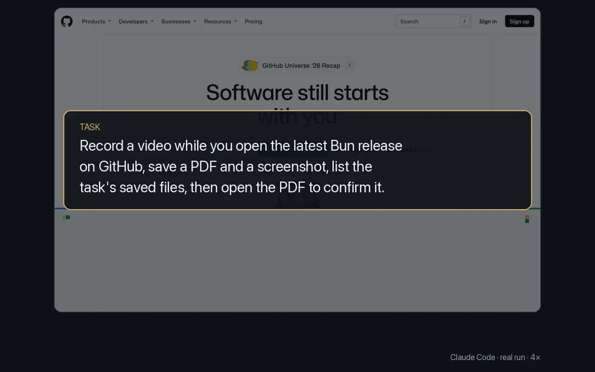

# Keep proof of what it did

<p align="center"></p>

Video recordings, PDFs and screenshots are saved for each task, and `browser sessions` lists them, so you can check the work afterwards.

Commands from the run:

```sh
browser record start
browser navigate https://github.com/oven-sh/bun/releases/latest
browser pdf
browser screenshot
browser record stop
browser sessions --no-interactive --search proof
browser navigate "file:///…/sessions/proof/1794226055385.pdf"
```

Its answer: release `bun-v1.4.4`; a recording, a 5-page PDF and a screenshot under the task's `sessions/proof/` folder, and the PDF opens in the browser.

- With no path, captures are saved under `~/.agents/browser/cache/<profile>@<device>/sessions/<task>/`. `screenshot -o <path>` and, from 0.2.7, `pdf <path>` save where you say.
- `browser start --record` records from the first page. A recording stops at `--duration` (60 s by default) or `--max-mb`, at `record stop`, or, from 0.2.7, at `done`.
- Recording needs ffmpeg; the first recording on a machine without it installs it.

More: [History and logs](../guide/history-and-logs.md).
