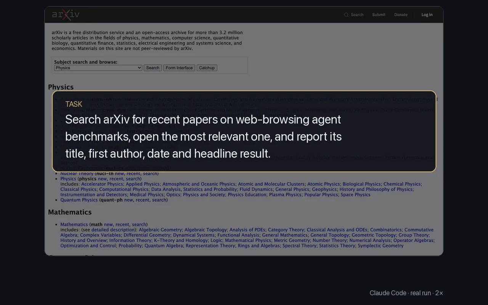

# Research papers and sources

<p align="center"></p>

Search, open the source and pull out what matters. `text --grep` keeps only the matching lines and `text --css` returns fields by selector, so reading a long paper costs few tokens.

The task given to Claude Code: search arXiv for recent papers on web-browsing agent benchmarks, open the most relevant one, and report its title, first author, date and headline result. The commands it ran:

```sh
browser navigate "https://arxiv.org/search/?query=web+browsing+agents+benchmark&searchtype=all&order=-announced_date_first"
browser text --css "li.arxiv-result"
browser navigate "https://arxiv.org/abs/2610.03574"
browser text --css "h1.title, div.authors, div.dateline, blockquote.abstract"
browser navigate "https://arxiv.org/html/2610.03574"
browser text --grep "accuracy|%|best|highest|human" --context 1
```

Its answer: HyperBrowseComp (Aji et al., 2 October 2026); the best agent answered 31.68% of the 423 questions.

- `text --css <selector> --attr href` returns each match's attribute instead of its text, with links made absolute.
- `text` also reads same-site and cross-site iframes in Chromium-family browsers.

More: [Driving a page](../guide/driving-a-page.md).
