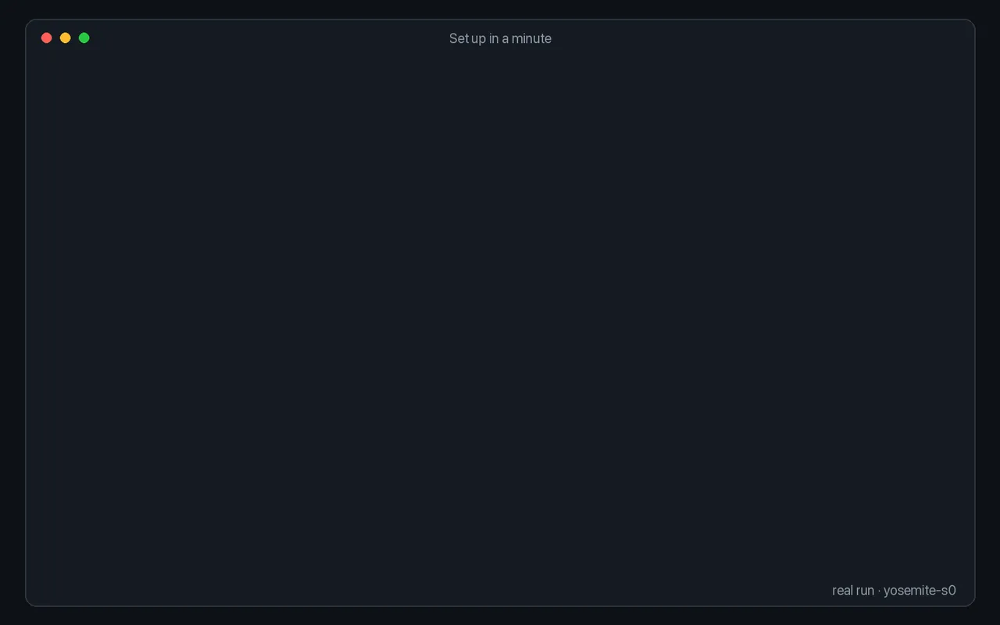

# Set up in a minute

<p align="center"></p>

Install the CLI and its skill, create a profile for the browser you already use, and the first page is one command away.

```sh
npm install -g @phnx-labs/browser-cli
npx skills add phnx-labs/browser-cli
```

The recording ran these commands on a Linux machine with Brave:

```console
$ browser profiles create work --browser brave --headless
Added "work" on box (port 9222).
$ browser use work
Default browser profile (this machine) is now "work" (brave, cdp://127.0.0.1:9222).
Bare `browser start` and `--profile default` will use it.
$ browser start --task hn --url https://news.ycombinator.com --snapshot
hn

Hacker News — https://news.ycombinator.com/
- link "Guidelines" [ref=1]
- link "FAQ" [ref=2]
...
$ browser click --task hn --text new --snapshot
Clicked (link "new")

New Links | Hacker News — https://news.ycombinator.com/newest
...
$ browser done --task hn
Completed task: hn
```

- `profiles create` takes `chrome`, `brave`, `edge`, `chromium`, `comet`, `arc` or `custom`. Firefox profiles are found from Firefox's own `profiles.ini` and appear in `browser profiles list` without a create step.
- Leave out `--headless` to see the window. A new profile starts signed out; sign in once in the window it opens.
- `start --snapshot` prints the task name, then the page's title, URL and numbered elements, so an agent can act on its first call.

More: [Getting started](../guide/getting-started.md), [Profiles](../guide/profiles.md).
