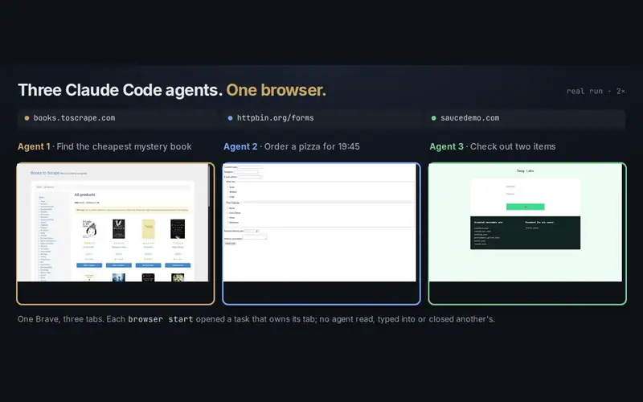

# Several agents, one browser

<p align="center"></p>

Every `browser start` opens a task that owns its tabs. Several agents can work in the same signed-in browser, and page commands from one task never act on another task's tabs.

```console
$ browser start --task shop --url https://books.toscrape.com
$ browser start --task form --url https://httpbin.org/forms/post

$ browser tabs --task shop
TAB         URL
eea868ea    https://books.toscrape.com/ *

$ browser text --task shop --tab f9060fe5        # the form agent's tab
Tab "f9060fe5" not found
```

- `browser tabs --all` lists every tab in the profile, with the task that owns it. Task ownership keeps agents from stepping on each other; it is not a sandbox, because an agent with a shell acts as you.
- Tasks whose agent has exited, or that sat unused for 30 minutes, are closed every five minutes. `browser prune` runs that now.
- Tasks open as tabs of one window. From 0.2.7, a task whose tab is not the selected one can still be recorded.

The three-agent run is measured in the [benchmarks](../benchmarks/README.md#several-agents-one-browser), and other tools are compared in [How it compares](../comparison.md).
