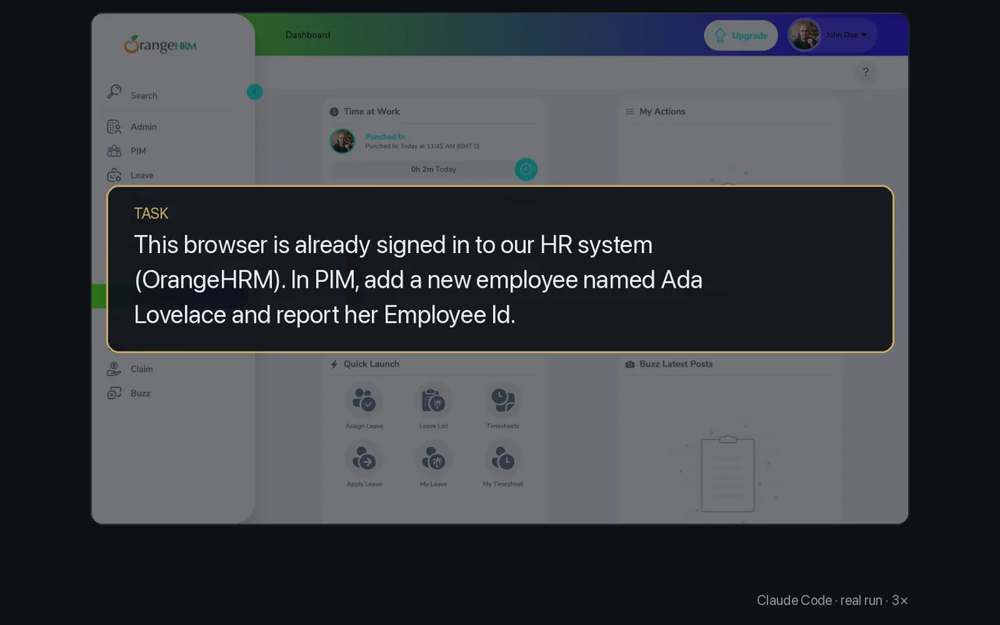

# Use the sites you are signed into

<p align="center"></p>

Sign in once in your own browser profile and your agent works in that session: HR, CRM and admin tools, including ones with no API or MCP server.

In the recording the profile was already signed in to OrangeHRM's public demo. The task: add an employee named Ada Lovelace in PIM and report her Employee Id. Commands from the run:

```sh
browser click --text "PIM"
browser click --text "Add" --snapshot
browser type 8 "Ada"
browser type 10 "Lovelace"
browser click 3 --snapshot
browser text --grep "Employee Id" --context 3
```

Its answer: saved, with Employee Id 0803.

- The agent never handles the password. Sign in yourself, once, in the window the profile opens.
- An agent with `browser` can do anything that profile can. Give agents a dedicated profile when they should not reach your personal accounts.
- To work in a browser you already have open and signed in, such as Comet, create the profile with `--attach-only` and start that browser with remote debugging; Arc profiles always attach.

More: [Profiles](../guide/profiles.md).
