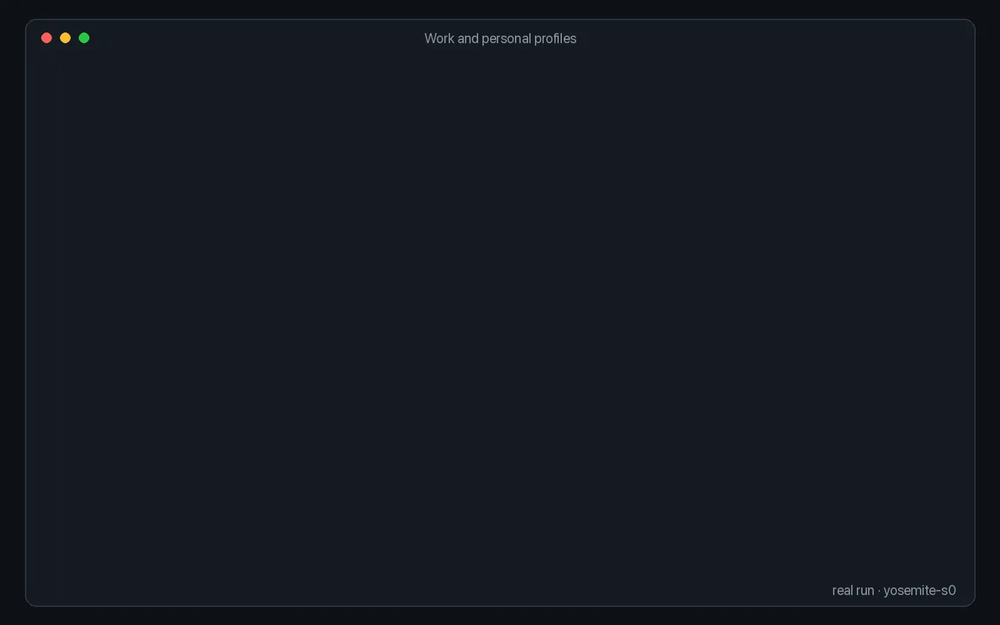

# Keep work and personal apart

<p align="center"></p>

Each profile has its own cookies and logins. Sign in once in the profile an agent should use, and other profiles never see that session.

From the recorded run, on a Linux machine with two Brave profiles:

```console
$ browser profiles create personal --browser brave --headless
Added "personal" on box (port 9223).
$ browser profiles list
  NAME      BROWSER  WHERE        ENDPOINTS
-------------------------------------------
* work      brave    box          cdp://127.0.0.1:9222
  personal  brave    box          cdp://127.0.0.1:9223

* = this machine's default profile (work) — what a bare `browser start` uses.
```

After signing in on `work` (`browser type Username …`, `browser type Password …`, `browser click --text Login`), the same protected page opens for one and not the other:

```console
$ browser start --profile work --task w2 --url https://the-internet.herokuapp.com/secure && browser text --task w2
w2
The Internet — https://the-internet.herokuapp.com/secure
...
$ browser start --profile personal --task p --url https://the-internet.herokuapp.com/secure && browser text --task p
p
The Internet — https://the-internet.herokuapp.com/login
...
```

- `browser use <name>` picks the profile a bare `browser start` uses; `--profile` picks one per task.
- `browser profiles logins` shows which supported sites (Google, GitHub, LinkedIn, X, Reddit) each profile is signed into, by checking for session cookies without decrypting them.
- Give agents their own profile when they should not reach your personal accounts.

More: [Profiles](../guide/profiles.md).
